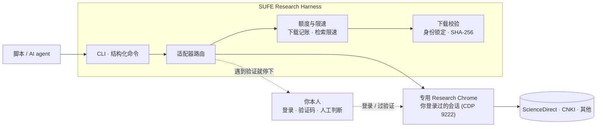

# SUFE Research Harness

给上海财经大学同学用的科研检索小框架。学校数据库登录好之后，把「检索、核对、下载、归档」这些机械但容不得错的活儿交给脚本，密码和验证码永远自己来。

Python 3.11+ · Chrome · Playwright

## 这玩意解决什么问题

做实证研究要在学校买的数据库之间反复往返：登录、检索、看权限、下载、改名、归档。每一步都不难，但都不能错——下错一篇、重复下载、短时间检索太多被出版商判定异常，代价都记在自己学校账号上。

让 AI 直接去「点网页」的坑在于：它会把「没看清」当「没有」，把「被拦住」当「失败了再试一次」。这个框架的做法是，把人和机器的边界画清楚，并且让边界由代码守，不靠自觉。

## 设计要点

1. **人工闸门。** 遇到登录、验证码、MFA、出版商的拒绝页，一律停下交还给你。脚本不输入密码，不碰 cookie，不自动过验证。
2. **写前记账的下载额度。** 每次下载前先记账，默认每天 15 篇、同一篇每天最多 2 次、下载间隔至少 15 秒。先记账再下载，失败也算数，不会因为「没成功」被反复重试。
3. **跨进程检索限速。** 两次检索至少间隔 20 秒。这是真踩过的坑：几分钟内并发检索，会话被出版商封了两次。
4. **不把「判断不了」报成结论。** 无法判定全文权限 ≠ 出版商拒绝；读不到页面 ≠ 验证页消失了。每种情况都有单独的状态。
5. **身份锁定与留档。** 下载的文件和检索目标逐一对上标题/DOI；原始文件算 SHA-256，生成不包含任何密码和 cookie 的清单。
6. **代码和数据分离。** 所有运行产物写在仓库外的目录，代码目录里不出现任何学校数据。
7. **专用 Research Chrome。** 用独立的 Chrome profile 保持登录态，脚本通过 CDP 附着操作，不碰你日常用的浏览器。

## 上财同学必看：WebVPN 的坑

实测下来，学校的 WebVPN 有几个毛病，这个框架按下面的方式绕：

| 数据库 | 情况 | 处理 |
|---|---|---|
| **知网 CNKI** | WebVPN 包装地址（`www-cnki-net-s.webvpn.sufe.edu.cn`）经常报「IP 不在许可范围」，或反复弹滑块验证码，IP 登录还会卡在「登录中」 | **不走 WebVPN**，直接开 `www.cnki.net` 用个人账号登录。登录一次，登录态存在专用 Chrome 里，长期有效 |
| **ScienceDirect** | WebVPN 包装地址正常，机构访问生效 | 走 WebVPN，直接检索下载 |
| 其他英文库（Springer、Oxford 等） | 走 WebVPN 包装地址即可 | 同上 |

数据库导航页（`az.php`）偶尔因为网络慢加载不全，脚本里做了等待重试，如果还不行就刷新一次页面再点。

## 快速上手

```powershell
# 1. 启动专用 Research Chrome（独立 profile + CDP 端口 9222）
powershell -ExecutionPolicy Bypass -File scripts\start_research_chrome.ps1

# 2. 在弹出的 Chrome 里自己登录 WebVPN（人工闸门，脚本不碰）

# 3. 用 CDP 附着，看登录态是否就绪
python scripts\attach_cdp.py

# 4. 检索 / 下载（示例见 docs\USAGE.md）
```

## 目录结构

```
SUFE-Research-Harness/
├── README.md
├── docs/
│   ├── USAGE.md            # 具体操作流程
│   ├── WEBVPN_BUGS.md      # 上财 WebVPN 实测记录
│   └── ARCHITECTURE.md     # 架构和设计取舍
├── scripts/
│   ├── start_research_chrome.ps1   # 启动专用 Chrome
│   ├── stop_research_chrome.ps1    # 关掉专用 Chrome
│   └── attach_cdp.py               # CDP 附着示例
└── config/
    └── databases.yaml      # 上财可用数据库清单
```

## 架构



适配器不直接操作 Playwright 对象，而是发类型化命令给浏览器端口，由本地 Playwright 执行；浏览器始终是你本人登录过的专用 profile。

## 许可证

GPL-3.0，参考 HUNNU Research Harness 的设计思路，代码按上财环境重写。
